# 数据流、接口与教学范围

```mermaid
flowchart LR
  A[TB bits] --> B[TB CRC / segmentation]
  B --> C[LDPC / rate matching]
  C --> D[Scrambling / QAM]
  D --> E[DM-RS / resource grid]
  E --> F[IFFT / CP]
  F --> G[Channel / AWGN]
  G --> H[Remove CP / FFT]
  H --> I[Estimate / equalize]
  I --> J[LLR / descramble]
  J --> K[Rate recovery / LDPC decode]
  K --> L[CB CRC / TB CRC]
```

## 固定端到端配置

- FR1，30kHz，normal CP，单slot14符号、单层、单发单收。
- 1..20个连续PRB，BWP/参考PRB起点0，无跳频，单码字。
- mapping type A，DM-RS type1、port0、l=2、maxLength=1、additionalPosition=0。
- 一个无数据CDM组，因此DM-RS符号内奇数子载波仍传数据。
- 无UCI、PT-RS、LBRM、变换预编码或完整调度控制面。
- MCS表5.1.3.1-1的0..16项，只覆盖QPSK和16QAM；Qm必须匹配MCS。
- Nfft=256，采样率7.68Msps，首CP=22，其他CP=18，slot长度3840样本。
- 等效载频fc=0，连续中心化子载波；不实现射频载频相位补偿。
- 默认6PRB、MCS4、R=308/1024、TBS=576、实际数据RE=972、G=1944。

## 长度链

| 符号 | 来源与单位 |
|---|---|
| A | 调度确定的TB信息比特数 |
| B | A加TB CRC，CRC16或CRC24A |
| C | 码块数量 |
| K′ | 每码块有效位，含可能的CB CRC24B |
| Kb | 选择Zc使用的系数 |
| Zc | 标准允许的提升尺寸 |
| K | 编码信息区长度：BG1=22Zc，BG2=10Zc |
| F | K-K′，filler数量 |
| N | 穿孔前2Zc之后：BG1=66Zc，BG2=50Zc |
| E | 每码块实际发送比特数 |
| G | 所有码块E之和；本配置为数据RE×Qm |

`LdpcEncode`返回**完整**码字，长度N+2Zc，用于独立校验。
`RateMatch`内部穿孔、跳过filler、选择和交织。
`RateRecover`返回N个LLR，`LdpcDecoderAdapter`负责量化并恢复K位。

主线输入来自合法TBS；任意长度若B无法被C整除会被明确拒绝。
这不是支持任意比特流分段的通用API。`CodingPlan`应由工厂函数生成。

## 数值与随机性

星座平均能量1，FFT两方向均除sqrt(N)。CLI中SNR为占用RE上的Es/N0，
不等于包含空子载波和CP的平均时域功率比，也不包含路径损耗预算。
复AWGN方差为N0，每个实分量为N0/2。LLR正值表示0。

译码适配层有限LLR乘4并限幅到[-63,63]；filler使用srsRAN的+127已知位表示。
量化影响性能，教程不声称接近浮点最优译码。默认15次迭代、外部CRC检查。
单独某个RV的短序列可能无法恢复TB；HARQ测试须在母码坐标上合并。

比特生成使用mt19937低位，可重复。正态分布的逐样本序列可能随标准库变化，
因此跨平台验证使用固定比特向量、浮点容差和统计指标，而不要求噪声样本逐字节一致。

## 支持与不支持

`RunLink`可选传入静态多径抽头，并选择解析频响基线或DM-RS估计；
抽头长度限定不超过最短CP。CLI默认单位信道加AWGN。

代码用于学习，不是完整UE/gNB或一致性测试系统。
完整UCI、MIMO、异步同步捕获、真实调度、38.901信道、数字孪生、实时多线程不在主线。
第20课的UCI索引是人为教学例子，明确不能用于真实NR空口。
后续可依次加入多DM-RS、频偏/定时估计、MIMO、TDL/CDL和实测校准。
